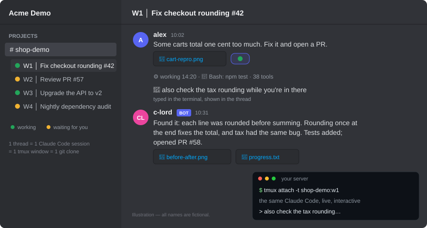

# c-lord

[](https://github.com/yousan/c-lord/actions/workflows/ci.yml)
[](../../pyproject.toml)
[](../../LICENSE)

**Discord から複数の Claude Code を並行で動かす。スレッドごとに別の git clone で作業するので、セッション同士が作業ツリーを取り合わない。**

c-lord は、自分のマシンで動く何本もの Claude Code を、Discord から見渡して動かせる「管制室」にします。作業ごとにスレッドを立てて任せたら、あとはスマホ・ノート PC・ターミナルのどこからでも様子を見るだけ。途中で切られることはなく、起きたことはすべてスレッドに残ります。

<p align="center">
  
</p>

## なぜ c-lord か

- 🎛️ **Discord が何本もの Claude Code の管制室になる。** スレッド1本が、あなたのマシンの tmux で動く本物の対話モードの Claude Code 1本です（ターミナルで使うのと同じもの）。スレッドにファイルを添付すれば Claude に渡り、Claude が作ったファイルは添付で返ってきます。キーボードで触りたくなったら、そのセッションに `tmux attach` で入れます。
- ⏳ **時間切れが無い。** 長くかかる作業が「長いから」という理由で止められることはありません。c-lord がターンを諦めるのは Claude の画面が5分間まったく動かなかったときだけで、そのときも Claude 自体は止めません。
- 🧪 **スレッドごとに丸ごと別の作業場所。** スレッドごとにリポジトリの別の clone で作業するので、サーバとフロントをセットで立てても、`docker compose` を立てても、ほかのスレッドとぶつかりません。どのコンテナがどのスレッドのものかを c-lord が把握していて、スレッドを畳むと一緒に止めます。（チャンネルを `/clord-init` でリポジトリに紐づけると有効になります。ホストのポートは共有なので、スタックごとに分けてください。）
- 📜 **作業が全部 Discord に残る。** 返事・ツールの動き・ファイルはもちろん、tmux のペインに直接打った分までスレッドに流れます。チームで見られますし、別の AI がその履歴を読んで作業を引き継げます。
- 🔒 **使える人を絞れる。** 何も設定しなければ、使えるのは Discord アプリの持ち主だけです（c-lord に話しかける＝あなたのマシンでコマンドを実行する、なので）。ロールや人を指定して広げることもできます。

**はじめる:** [クイックスタート](#クイックスタート) · [しくみ](#基本的なアイデア-スレッドごとに独立した-clone-で並行セッション) · [コマンド一覧](COMMANDS.md) · [設定](#設定) · [アーキテクチャ](#アーキテクチャ)

[English](../../README.md) · 日本語 · [简体中文](../zh-CN/README.md) · [한국어](../ko/README.md) · [Español](../es/README.md) · [Português](../pt-BR/README.md) · [Français](../fr/README.md)

このページは[英語版 README](../../README.md) と同じ内容を日本語で書いたものです。食い違いがあれば英語版が正です。

> **[@ebibibi](https://github.com/ebibibi)（Masahiko Ebisuda）さんの [claude-code-discord-bridge](https://github.com/ebibibi/claude-code-discord-bridge) がもとになっています。** このプロジェクトは ebibibi さんが作ったもので、MIT ライセンスのもとで使わせてもらっています。素晴らしい土台に感謝します。

> c-lord は独立したオープンソースプロジェクトです。Anthropic が作っているものでも、後援・公認しているものでもありません。「Claude」「Claude Code」は Anthropic の商標です。c-lord は、あなたが自分でインストールしてログインした Claude Code CLI を動かすだけです。

**このページの内容:** [しくみ](#基本的なアイデア-スレッドごとに独立した-clone-で並行セッション) · [クイックスタート](#クイックスタート) · [スレッドでの使い方](#スレッドでの使い方) · [ワークスペース](#ワークスペース) · [コマンド](#コマンド) · [設定](#設定) · [スケジュールタスク](#スケジュールタスク) · [GitHub と CI](#github-と-ci-からの自動化) · [REST API](#rest-api) · [ライブラリとして使う](#ライブラリとして使う) · [アーキテクチャ](#アーキテクチャ) · [セキュリティ](#セキュリティ) · [開発](#開発) · [作り方](#このプロジェクトの作り方)

## 基本的なアイデア: スレッドごとに独立した clone で並行セッション

Discord の各スレッドは、それぞれが 1 つの Claude Code セッションで、サーバー上の専用 tmux ウィンドウで動きます。複数のスレッドにタスクを送れば並行して走り、ラップトップを閉じても動き続け、スレッドに返信すれば続きから再開できます。

並行セッションが互いの作業を壊さない理由は **隔離** です。チャンネルをリポジトリに紐づけると（`/clord-init`）、各スレッドはそれぞれ独立した `git clone` の中で作業します。セッション同士が作業ツリーを共有しないので、あるスレッドの未コミットの変更が別のスレッドに現れることはありません。セッションが出会うのは git リモート（ブランチ・push・PR）だけで、人間の開発者どうしと同じです。

```text
スレッド A (機能開発)    ──→  Claude Code  (専用 clone)  ─┐
スレッド B (PR レビュー)  ──→  Claude Code  (専用 clone)   ├─→  git リモート（ブランチ・PR）
スレッド C (ドキュメント) ──→  Claude Code  (専用 clone)  ─┘
```

**現在、セッション同士は互いに調整していません。** 以前のこの README は 4 つの協調の仕組みを説明していましたが、実際の状態は次のとおりです（[#758](https://github.com/yousan/c-lord/issues/758)）:

| 仕組み | 実際の状態 |
|---|---|
| **並行処理の注意書き**（並行作業について Claude に伝える指示） | **組み立てていません** — セッションは tmux TUI で動いており（#53）、ターンごとにシステムプロンプトを渡す経路が無いため一度も届いておらず、組み立ても止めました（#766） |
| **アクティブセッションレジストリ** | メモリ上に存在し `/workspace-cleanup` が使っていますが、**セッション側からは見えません**（セッションに渡す経路が無いため） |
| **協調チャンネル** | **既定でオフ。** `COORDINATION_CHANNEL_ID` を設定すると、セッションのターンが終わったときに 1 行の通知を投稿します。開始イベントはありません |
| **AI Lounge** | REST エンドポイントは動きますが、**Claude にラウンジの存在を伝えるものが何も無い**ため、実際には誰も投稿しません — 下の「AI Lounge（セッションには届いていません）」を参照 |

つまり、作業ツリーは分かれていますが、リアルタイムの協調はありません。clone の外にあるもの — 同じリモートブランチ、共有のポートやデータベース、staging Bot など — は衝突しえます。スレッドごとに別のブランチを使ってください。

### AI Lounge（セッションには届いていません）

> **状態: 配線されていません**（[#758](https://github.com/yousan/c-lord/issues/758)）。ラウンジは、一時的なシステムコンテキストとしてすべてのセッションに注入される設計でした。しかしセッションは tmux TUI で動いており（#53）、ターンごとにそれを渡す経路が無いため、c-lord はその文字列を組み立てていません（#766）。Claude にはラウンジの存在が伝わらず、実際には誰も投稿しません。

REST エンドポイント自体は動くので、自分で使うことはできます — たとえばリポジトリの `CLAUDE.md` にラウンジのことを書いておく方法があります:

```bash
# メモを投稿（SQLite に保存。ラウンジチャンネル — 既定は COORDINATION_CHANNEL_ID — にも転送）
curl -X POST "http://localhost:8080/api/lounge" \
  -H "Content-Type: application/json" \
  -d '{"message": "feature/oauth で auth リファクタリング開始", "label": "機能開発"}'

# 最近のメモを確認
curl "http://localhost:8080/api/lounge"
```

## クイックスタート

必要なのは、電源を入れたままにしておける Linux マシン（WSL2 でも動きます）と、次のものです。

- Python 3.10 以上と [uv](https://docs.astral.sh/uv/)
- `git` と `tmux`
- [Claude Code CLI](https://docs.anthropic.com/en/docs/claude-code)。ログインまで済ませておきます（一度 `claude` を手で起動して確かめてください）
- bot を追加できる権限のある Discord サーバー

### ステップ 1 — Discord の bot を作る

1. [Discord Developer Portal](https://discord.com/developers/applications) を開き、**New Application** でアプリを作ります。
2. **Bot** のページで、*Privileged Gateway Intents* の **Message Content Intent** をオンにし、bot の**トークン**をコピーします。
3. **OAuth2 → URL Generator** で、スコープに `bot` と `applications.commands` を選び、bot の権限として次を選びます。

   | 権限 | 何に使うか |
   |---|---|
   | View Channel | そもそもチャンネルが見えるようにする（下の注意を参照） |
   | Send Messages、Send Messages in Threads | 返事の投稿 |
   | Create Public Threads | セッションごとにスレッドを 1 本立てる |
   | Read Message History | bot が止まっていた間に届いた投稿を読み直す |
   | Add Reactions、Manage Messages | あなたのメッセージに付く状態ランプと、その付け替え |
   | Manage Webhooks（任意） | サブエージェントの発言を、その名前で投稿する（`CLORD_SUBAGENT_VOICES=1`） |

4. 生成された URL を開き、bot をサーバーに追加します。

> **プライベートチャンネル・権限を絞ったチャンネルの場合:** チャンネルが `@everyone` の
> **View Channel** を拒否している（プライベートチャンネル）と、上のサーバー全体への招待だけでは
> *足りません*。チャンネル単位の拒否がサーバー全体の許可より優先されるためです。そのチャンネルの
> 権限設定に **bot のロール**（または bot 自身）を追加し、少なくとも **View Channel**・
> **Create Public Threads**・**Send Messages**・**Send Messages in Threads** を許可してください。
> 「Manage Threads」だけを許可しても解決**しません**。
>
> bot にこれらの権限が足りないチャンネルでは、**`/clord` が付与すべき権限をそのまま（自分にだけ
> 見える形で）教えてくれます**（#443）。スラッシュコマンドは、bot からチャンネルが見えていなくても
> 届くからです。先へ進む前に権限を直してください。**View Channel** が無いと、そのチャンネルの
> メッセージは bot に届かないので、そこのスレッドに書いたことは Claude に届きません。

### ステップ 2 — セットアップウィザードを実行する

`.env` はウィザードが書きます。手で編集するものはありません。

```bash
# GitHub から直接。インストール不要:
uvx --from "git+https://github.com/yousan/c-lord.git" c-lord setup

# clone して使う場合（サービスとして常駐させるならこちら）:
git clone https://github.com/yousan/c-lord.git
cd c-lord
uv run c-lord setup
```

聞かれるのは次の 6 つで、この順番です。

1. **Claude Code CLI** — `claude` が実行できるかを確かめるだけです。できなければそう伝えます。
2. **bot のトークン** — Discord API に問い合わせて確かめます（`Bot xxx` の形で貼っても `xxx` として保存します。空や無効な入力が 3 回続くと、`.env` を書かずに終了します）。
3. **チャンネル** — bot から見えるテキストチャンネルを一覧にするので、番号で選びます（ID をコピーする必要はありません）。数字のチャンネル ID を貼ることもできます（チャンネルの URL や `²` のような数字は聞き直します）。これが `DISCORD_CHANNEL_ID`、つまり bot のホームチャンネルになります。
4. **あなたの Discord ユーザー ID** — 任意です。メンションの宛先になります。数字の ID ではなくユーザー名を入れると聞き直します（`c-lord start` が受け付けないため）。
5. **作業ディレクトリ** — 専用の clone を持たない実行で使う、既定のディレクトリです。
6. **モデル** — `sonnet`・`opus`・`haiku` のいずれか。

最後に `.env` を書き（`--env PATH` で別の場所にも書けます）、その場で bot を起動するかを尋ねます。

### 起動と停止

```bash
c-lord start    # bot を起動（カレントディレクトリの .env を読む）
c-lord start --env /path/to/.env   # .env の場所を指定
c-lord version  # 動いているビルドを表示。例: v1.4.183-bd80c47e-20260908
```

clone の中では頭に `uv run` を付けます。この方法で起動した bot はフォアグラウンドで動き、Ctrl-C で止まります。動かし続けたいときは[サービスとして常駐させる](#サービスとして常駐させる)を見てください。

> **設定の優先順位（#324）:** `.env` に書いてあるキーは、引き継がれたプロセスの環境変数より
> 常に優先されます。つまり、どのディレクトリから起動したかで bot の身元が決まります。
> `.env` に*無い*キーはこれまでどおりプロセスの環境変数から読むので、環境変数だけで
> 設定している場合もそのまま動きます。

### ステップ 3 — リポジトリを紐づけてセッションを始める

セッションはスラッシュコマンドで始めます。チャンネルに普通に書いたメッセージでは始まりません（無視されます。だからチャンネルは普段の会話の場として使い続けられます）。

```text
/clord-init repo:https://github.com/you/your-project.git     ← チャンネルごとに 1 回
/clord ログインのテストが時々落ちるのを直して                    ← スレッドが立ち、そこで Claude が動き出す
```

`/clord-init` は、そのチャンネルがどのリポジトリで作業するかを記録します。Discord の既定では、**サーバー管理（Manage Server）**の権限を持つメンバーにだけ表示されます。以後は `/clord` のたびに新しいスレッドが立ち、そのスレッド用にリポジトリが clone され、clone の中で Claude Code が起動します。**そのスレッドの中に**書いたものは、すべて同じ Claude のセッションに届きます。あるスレッドだけ別のリポジトリを使いたいときは `/clord repo:<url> <依頼>` と指定します。これは紐づけの無いチャンネルでも使えます。

clone はホスト自身の git の認証情報で行うので、プライベートリポジトリを使うにはホストに SSH 鍵か credential helper を用意しておきます。clone に失敗したときは、git 自身のエラーと、次に確かめることがスレッドに出ます（[あるべき動き](../specs/workspace-setup-failure.md)）。

### サービスとして常駐させる

c-lord をバックグラウンドで動かし続け、**ホストを再起動しても自動で立ち上がる**ようにするには、`systemd --user` のサービスとして入れます。clone の中で次を実行します。

```bash
bash scripts/install-systemd.sh
```

これは [`deploy/c-lord.service`](../../deploy/c-lord.service) をそのまま `~/.config/systemd/user/c-lord.service` として置き、ホストごとに違う値（この clone のパス、`uv` の場所、`PATH`）を drop-in の `c-lord.service.d/10-install.conf` に書き、サービスを有効にし、**linger** をオンにします。linger があるので、誰もログインしていなくても起動時にサービスが立ち上がります。`deploy/c-lord.service` が変わったら、もう一度実行してください。あとは普通の systemd の操作です。

```bash
systemctl --user restart c-lord.service     # `git pull` のあとに
systemctl --user stop    c-lord.service
systemctl --user status  c-lord.service
journalctl --user -u c-lord.service -f      # ログを流し見る
```

unit を入れたあとは、**この clone の bot を起動するのは systemd だけ**にしてください。手で kill して手で起動すると、systemd が立て直そうとして二重起動防止のロックに当たり、あきらめ（`Start request repeated too quickly`）、bot が監視されないまま動き続けることになります。`bash scripts/staging.sh restart|stop` はこれを心得ていて、ユーザー unit の `WorkingDirectory=` が指している clone では、kill する代わりに `systemctl --user restart|stop` を呼びます。`systemctl --user` が使えないときは、kill せずにエラーで止まります。`bash scripts/staging.sh status` を見れば、bot の各プロセスが unit の cgroup の中にいるかどうかが分かります。

システムのサービスではなく `--user` にしている理由: c-lord はそのユーザーの `tmux`、`~/.claude` のセッションファイル、`uv`、`claude` CLI を使うので、**あなた自身として**、あなたの環境で動かすのがいちばん素直です。root のサービスにすると、それらを `User=` や `Environment=` で作り直すことになります。ユーザーのサービスがログアウト後も生き残り、起動時に立ち上がるのは `loginctl enable-linger "$USER"` のおかげで、これはインストーラが実行します。

> **手で入れる場合:** [`deploy/c-lord.service`](../../deploy/c-lord.service) をコピーし、
> 2 か所の `CHANGE-ME`（clone のディレクトリと `uv`）を直してから、
> `systemctl --user daemon-reload && systemctl --user enable --now c-lord.service && loginctl enable-linger "$USER"`。

> **WSL の場合:** `systemctl --user` が `Failed to connect to bus` と言うときは、ユーザーの
> D-Bus セッションが上がっていません。`/etc/wsl.conf` の `[boot]` に `systemd=true` があることを
> 確かめて WSL を再起動する（`wsl --shutdown`）か、bot を kill して `Restart=always` に
> 立て直させてください（clone が複数あるときの `pkill -f c_lord.main` は危険です。PID で kill します）。

## スレッドでの使い方

ここからは、Discord で実際に目にするものの説明です。各項目には、その機能が「どう動くべきか」を定めたページへのリンクを付けました。一覧は [docs/specs/](../specs/README.md)、日々の使い方は[利用者ガイド](USER_GUIDE.md)にあります。

### Claude と話す

- **1 スレッド = 1 つの会話。** スレッドに返信すると、同じ Claude Code のセッションが文脈を保ったまま続きます（`--resume`）。今日でも、明日でも、bot を再起動したあとでも同じです。
- **新しいメッセージは割り込みになります。** Claude が作業している最中に書くと、走っているターンは中断され、新しい指示が実行されます。先に `/stop` する必要はありません。
- **止める。** `/stop`、またはターン中にスレッドの末尾に出る **⏹ Stop** ボタンで、ターンと、Claude が動かしたままのシェルコマンドが止まります。会話は残り、次のメッセージで続きから始まります（[あるべき動き](../specs/stop-button.md)）。
- **送る文章に長さの制限はありません。** 長い貼り付けも全文が届きます。どうしても届けられないときは、スレッドにそう出ます。何も言わずに空のターンが終わることはありません（[あるべき動き](../specs/input-delivery.md)）。
- **ファイルを渡す。** 1 つのメッセージに 10 個まで添付できます。それぞれスレッドの clone の中（`.clord/attachments/…`。git の対象外）に保存され、Claude にはそのパスが伝わります（[あるべき動き](../specs/attachments.md)）。
- **ファイルを受け取る。** Claude が渡したファイルは、元の名前のままスレッドに添付されます。既定では 25 MB までです（[あるべき動き](../specs/user-file-delivery.md)）。
- **長い返事も欠けずに届きます。** Discord の 2000 文字の上限を超える返事は、コードブロックを壊さないように複数のメッセージに分けて届きます（[あるべき動き](../specs/long-reply-split.md)）。
- **ターミナルもそのまま使えます。** スレッドのウィンドウに `tmux attach` して打てば、打った内容はあなたの発言としてスレッドに出て、Claude の返事もいつもどおり続きます（[あるべき動き](../specs/mirrored-events.md)）。
- **bot が止まっていた間の投稿は失われません。** 再接続・再起動したとき、その間にスレッドへ届いていた依頼を読み直して実行します。遅れた理由が 1 行添えられます（[あるべき動き](../specs/gateway-backfill.md)）。
- **スレッド名はあなたのもの** — c-lord が勝手にスレッド名を要約し直すことはありません。スレッドは開いたときの名前のままです（前に `W<N> │`、作業中の `#<issue>` 番号が付くだけ）。直近の会話から名前を付け直したいときは、スレッドで `/thread-rename` を実行します（sonnet）。`CLORD_AUTO_TOPIC=1` で、以前の自動要約に戻せます（#705）

### いま何が起きているかを知る

- **リアルタイムの状態** — あなたのメッセージに付く絵文字リアクションがランプです。Claude が作業している間は 🟢、あなたの番になると 🟡（エラーは ❌、10 秒 / 30 秒静かだと ⏳ / ⚠️）。利用が多いときもリアクションはすぐ切り替わります。スレッド名の 🟢/🟡 ランプは既定でオフです（#329）。サイドバーで見たいときは `CLORD_THREAD_LAMP=1` にしますが、こちらは反映が遅めです（#246）
- **ツールの様子** — ツールごとに投稿はしません。Claude Code 自身の会話記録から読み取り、ターンが静かになると進捗の 1 行（`⚙️ 作業中 5:56 · 🔧 Bash(…) · ツール 61 件`、下の「ターン中の進捗表示」）を出し、そのターンのツール呼び出しと途中経過の文章は、返事に `progress.txt` として添付します（#723）
- **ターン中の進捗表示** — ターンが 90 秒黙ると、小さな文字の 1 行（`⚙️ 作業中 5:56 · 🔧 Bash(…) · ツール 61 件`）が出ます。15 秒ごとにその場で書き換わり、実際の出力が戻った瞬間に消えます。ツールの動きまで止まっているときは `⏳ 待機中` になります。Claude が途中経過の文章（ペインの「●」の行）を書いたときは、ツール名の代わりにいちばん新しい文章を出します（#883）。その文章も `progress.txt` に入り、1 つずつメッセージとして投稿されることはありません。ターンの外では出ません。`CLORD_TURN_PROGRESS=0` で止められます（#539）
- **コンテキストの使用率** — ターンの終わりに 1 行のフッタ（`📊 7% context (69k/1.0M) · …`）が付きます。コンテキストウィンドウの使用率（入力＋キャッシュのトークン。出力は含みません）、モデル、バージョン、コストです。83.5% を超えると ⚠️ の警告に変わります。次のターンで自動の圧縮が走るかもしれない、という意味です（`docs/specs/context-footer.md`）
- **圧縮の知らせ** — Claude Code がコンテキストを圧縮すると、引き継ぎ用の要約をそのまま流す代わりに、スレッドに `🗜️ コンテキストを圧縮しました` の 1 行が出ます（#628）
- **固まったときのランプ** — 30 秒何も動きが無いと、あなたのメッセージのリアクションが ⚠️ になります（長く考えているときや圧縮中も同じくらい静かです）。スレッドには何も投稿しません（#473）
- **ターン終了の呼び出し** — ターンが終わると、依頼した人にメンションが飛ぶので、通知で気づけます。何も返事が無かったターンは、終わったとは言わず、返事が無かったと伝えます（[あるべき動き](../specs/turn-end-notification.md)）。
- **タイムアウトの通知** — 経過時間と再開の手順を書いた embed です。Claude が本当に動けなくなったとき（所定の時間ずっとペインが固まっていて、*かつ*入力待ちでもないとき）にだけ出ます。普通に終わったターンでは出ません（#541）。質問やプランのメニューがあなたの答えを待っている間も出ません（#751）
- **利用上限とログイン** — プランの利用上限に当たったときは、そのとおりに、回復する時刻と一緒に伝えます（[あるべき動き](../specs/usage-limit.md)）。Claude Code のログインが切れたときは、ホスト名と止まったスレッドを書いた DM が owner に 1 通届き、その DM からログインし直せます（[あるべき動き](../specs/login-alert.md)）。
- **📊 Session Status ボード** — 既定でオフです（#761）。`CLORD_SESSION_STATUS_BOARD=1` にすると、`DISCORD_CHANNEL_ID` のチャンネルに、各セッションを 🟢 Auto-processing / 🟡 Waiting for input として並べたボードを 1 枚、常に更新しながら置きます。オフの間、起動した bot はチャンネルに何も投稿せず、以前の起動が残したボードは片付けます。スレッドに出るターン終了の `🟡 Claude has finished … @you` には影響しません。`docs/specs/session-status-board.md` を参照

### Claude から質問されたとき

- **質問** — Claude が `AskUserQuestion` を呼ぶと、選択肢がスレッドにボタンかセレクトメニューとして出て、選んだもので Claude が続けます。ボタンは bot を再起動したあとも押せます（[あるべき動き](../specs/ask-menu-lifecycle.md)）。
- **Plan Mode** — Claude が `ExitPlanMode` を呼ぶと、Claude Code が出す承認メニューを `AskUserQuestion` と同じ仕組みで Discord に橋渡しします。選択肢がボタンになり、選んだもので Claude が進みます（#251）
- **ツール実行の許可プロンプト** — Discord には出ません。Claude Code の許可プロンプトは c-lord がペインの中で承認するので、ターンは止まりません。Claude に何を許すかは、ツールごとのボタンではなく、セッションの permission mode と設定で決まります

### 作業を分ける

- **サブエージェントのログ** — 1 つのスレッドの中でサブエージェントに分けた作業も Discord に残ります。走りごとに `🤖 サブエージェント「…」開始` / `終了 · 6:12 · ツール 48 件` の行が出て、終了の行には `subagent-*.md`（報告の全文・依頼・ツール呼び出し）が付きます。走っている間は、開始の行の添付が差し替わっていきます。`CLORD_SUBAGENT_VOICES=1` にすると、各エージェントの発言と報告がそのエージェントの名前で出ます（#971、`docs/specs/subagent-log.md`）

**新しいスレッドを立てるとき、1 本の中で分けるとき**（#969）: 新しいスレッドを立てるのは、その作業に専用のブランチ、専用の開発サーバー、あるいはあなたとの専用の会話が要るときだけにします。1 つの作業（調査・レビュー・仕分け）を分けたいときは、スレッドの中で Claude にサブエージェントを使うよう頼みます。追加の `claude` プロセス（1 本あたり約 285 MB）は起動せず、それでいて各サブエージェントの開始・終了・報告の全文がスレッドに届きます（[サブエージェントのログ](../specs/subagent-log.md)）。Agent Teams（`CLAUDE_CODE_EXPERIMENTAL_AGENT_TEAMS`）は実験的な機能で、c-lord がセッションを再起動・再開したときにチームメイトは戻ってきません。分割ペイン表示（`--teammate-mode tmux`）は使わないでください。c-lord が操作しているウィンドウにペインが増えてしまいます。

### スキル、モデル、コミット

- **スキル** — `/skill` で、`~/.claude/skills/` にある Claude Code のスキルを実行します。名前は入力補完され、bot が動いている間に足したスキルも 1 分以内に出てきます。チャンネルで使うと新しいスレッドが立ち、スレッドで使うとそのセッションの続きになります。
- **実行中のモデル切り替え** — `/model` で、モデルと effort をセッション・チャンネル・全体のどの範囲でも表示・変更できます（`include-existing` を付けると、開いているセッションにも次のターンから反映されます）
- **誰が頼んだコミットか** — スレッドで Claude が作るコミットには、そのターンを頼んだ Discord ユーザーと Claude の `Co-authored-by:` が付きます。Claude に覚えておいてもらうのではなく、git のフックで付けています。`CLORD_COAUTHOR=0` で止められます（[あるべき動き](../specs/commit-coauthors.md)）。

## ワークスペース

**ワークスペース**は、1 本のスレッドに属するもの一式です。Claude のセッション、clone、そしてその clone から立ち上げた docker の環境を指します。

- **スレッドごとに専用の git clone** — チャンネルをリポジトリに紐づけると（`/clord-init`）、各スレッドは独立した `git clone` の中で作業します。セッション同士が共有するのは git リモートだけです
- **「止める」には 3 段階あり、後のものは前のものを含みます。** どの操作でも、会話の履歴と docker の volume は消えません（[用語](../specs/workspace-vocabulary.md)）。

  | | 止まるもの | 自動 | 手動 |
  |---|---|---|---|
  | **スリープ** | `claude` のプロセス（docker は動いたまま） | 4 時間操作が無いとき（`CLORD_IDLE_SLEEP_HOURS`） | なし。次のメッセージで何も言わずに起きます |
  | **停止** | ＋ docker の環境 | 7 日間操作が無いとき（`CLORD_IDLE_STOP_DAYS`） | `/workspace-stop`。戻すのは `/workspace-start` |
  | **削除** | ＋ clone そのもの | 30 日間使われなかったとき（下記） | `/workspace-delete` |

- **起きていられる本数の上限。** `CLORD_MAX_RESIDENT_WORKSPACES`（既定ではホストのメモリから算出）を超えると、いちばん長く使われていないワークスペースからスリープします。新しく始めるほうが待たされることはありません（[あるべき動き](../specs/resident-cap.md)）。
- **チャンネルの状態** — `/clord-status` で、このチャンネルのセッションが、ディレクトリの容量、`tmux attach` の宛先、`claude --resume` のコマンドと一緒に一覧で出ます。`show_all` を付けると閉じたセッションも含みます（`docker ps -a` と同じ感覚）。以前の `/sessions`・`/session-dirs`・`/resume-info` をまとめたものです。
- **ワークスペースの回収** — `/workspace-cleanup` で、動いているどのセッションも使っていない clone のディレクトリを回収します（`dry_run` で事前に確認できます）。作業が残っているディレクトリ（未コミットの変更、push していないコミット、`.env` のような ignore されたファイル）は決して消さず、どれを残したかを返事に書きます（#1016）
- **30 日の片付け（知らせ付き）** — 起動のたびに、**30 日間**使われていないワークスペースを片付けます。この期間は Claude Code 自身の会話記録の保持期間（`cleanupPeriodDays`）に合わせてあるので、その頃には Claude のほうも会話を覚えていないのが普通です。clone を消すのは未コミットの作業が無いときだけで、スレッドとセッションを結ぶ記録は残します。まだ開いているスレッドには、何が起きて何が残っているかを書いた 🧹 の知らせが出て、そのあとアーカイブされます。すでに閉じているスレッドは投稿なしで片付けるので、閉じたままです。あとでそのスレッドに書き込むと、ディスクに残っているものに繋ぎ直すか、同じスレッドで新しい会話として始まります。詳しくは [Why a thread loses its record](../COMMANDS.md#why-a-thread-loses-its-record-the-30-day-sweep)（英語）。
- **clone は git のオブジェクトを共有します。** 同じリポジトリの clone は、ローカルの 1 つのミラーからオブジェクトを借りるので、新しいスレッドの clone は数秒で済み、ディスクもほとんど使いません。git の使い方は何も変わりません。`CLORD_GIT_MIRRORS=0` で止められます（[あるべき動き](../specs/git-object-mirrors.md)）。

## コマンド

すべてのコマンドの説明は **[コマンドリファレンス](COMMANDS.md)** にあります。よく使うのは次のものです。

| コマンド | 場所 | すること |
|---|---|---|
| `/clord-init repo:<url>` | チャンネル | チャンネルをリポジトリに紐づける（引数なしで、いまの紐づけを表示） |
| `/clord <prompt>` | チャンネル | スレッドを立ててセッションを始める。`repo:<url>` でそのスレッドのリポジトリを指定 |
| `/stop` | スレッド | 走っているターンを止める。会話は残る |
| `/clear` · `/compact` | スレッド | 同じスレッドで最初からやり直す · コンテキストを要約して空きを作る |
| `/skill <name> [args]` | チャンネルかスレッド | Claude Code のスキルを実行する |
| `/model` | どこでも | モデルと effort を、セッション・チャンネル・全体の単位で表示・変更する |
| `/clord-status` | どこでも | このチャンネルのセッション。`tmux attach` の宛先と `claude --resume` のコマンド付き |
| `/workspace-stop` · `/workspace-start` · `/workspace-delete` · `/workspace-cleanup` | スレッド / どこでも | [ワークスペース](#ワークスペース)の操作 |
| `/claude-restart` · `/resync` · `/tmux-screenshot` | スレッド | Claude のプロセスを再起動する · スレッドをペインに繋ぎ直す · ペインの画像を投稿する |
| `/thread-rename` | スレッド | スレッド名を要約し直す |
| `/clord-reattach` | スレッド | 片付けられたスレッドを、ディスクに残っているものに繋ぎ直す |
| `/version` | どこでも | 動いているビルドを表示する |

ほとんどのスラッシュコマンドには、頭に `!` を付けたテキスト版もあります（`!clord`、`!stop` など）。webhook から送れるのはこちらです（Discord は webhook にスラッシュコマンドを使わせません）。スクリプトやほかのエージェントが作業を始めるときもこれを使います。リポジトリに紐づいたチャンネルに、`!clord` で始まるメッセージを webhook で投稿すると、セッションが始まります。

## 設定

設定はすべて `.env` に書きます。必須なのは最初の 2 つだけです。[.env.example](../../.env.example) はコメント付きのひな形で、全部の一覧ではありません。下の表にある変数の一部は入っておらず、逆に、ここに載せていないもの（テストや監視の道具のための変数）がいくつか入っています。

**接続**

| 変数 | 意味 | 既定 |
|---|---|---|
| `DISCORD_BOT_TOKEN` | bot のトークン | （必須） |
| `DISCORD_CHANNEL_ID` | Claude と話すチャンネルの ID。ここに出てくる ID の設定（`DISCORD_OWNER_ID`、`COORDINATION_CHANNEL_ID`、`EXPECTED_BOT_USER_ID`）はどれも ASCII の数字だけで書きます。リンク、名前、`²` などが入っていると、`c-lord start` はその設定名と値を示して止まります（#1084）。数字の前後の空白は無視します（#1194） | （必須） |
| `EXPECTED_BOT_USER_ID` | bot 自身のユーザー ID。別の bot としてログインしてしまったら、その場で終了します。1 台のホストで複数の bot を動かすときに設定しておくと安全です | （オフ） |

**Claude Code**

| 変数 | 意味 | 既定 |
|---|---|---|
| `CLAUDE_COMMAND` | 実行する Claude Code のコマンド | `claude` |
| `CLAUDE_MODEL` | 新しいセッションのモデル。動かしながら `/model` で変えられます | `sonnet` |
| `CLAUDE_EFFORT` | `--effort` として渡す推論の effort（`low` / `medium` / `high` / `xhigh` / `max`）。未設定ならフラグを渡しません | （CLI の既定） |
| `CLAUDE_PERMISSION_MODE` | セッションの permission mode | `acceptEdits` |
| `CLAUDE_WORKING_DIR` | 専用の clone を持たない実行（`working_dir` の無いスケジュールタスクや webhook トリガー）で使うディレクトリ | カレントディレクトリ |
| `CLORD_SESSION_PLUGINS` | `0` にすると、セッションを起動するときに Discord プラグインと不要な言語サーバーのプラグインを外す動きを止めます（[あるべき動き](../specs/session-plugins.md)） | `true` |

**誰が使えるか**

| 変数 | 意味 | 既定 |
|---|---|---|
| `DISCORD_OWNER_ID` | bot を動かせるユーザーの ID。Claude が入力を待つときのメンションの宛先でもあります。未設定なら、Discord アプリの持ち主だけが使えます（#713） | （任意） |
| `CLORD_ALLOWED_ROLE` | このロール名のメンバーも bot を動かせます（`DISCORD_OWNER_ID` との OR） | （任意） |
| `CLORD_ALLOW_ANYONE` | `1` にすると、サーバーの**全員**が bot を動かせます。つまり、ホストでシェルコマンドを実行できます。起動時に警告が出ます | `false` |
| `CLORD_NOTIFY_DENIED` | `0` にすると、許可されていない人が bot のスレッドに投稿したときにアプリの持ち主へ届く DM を止めます（投稿した本人には何も見えません。拒否したことはログに残ります — #346） | `true` |
| `CLORD_HOST_LABEL` | ログイン切れの DM で、このマシンをどう呼ぶか（#1309。2 台目のホストと見分けるため） | ホスト名 |
| `CLORD_LOGIN_RELAY` | `0` にすると、ログイン切れの DM は届きますが、その DM からのログインし直し（サインイン用リンクとコードの返信、#1310）はできなくなります | `true` |

**上限とワークスペース**

| 変数 | 意味 | 既定 |
|---|---|---|
| `MAX_CONCURRENT_SESSIONS` | **同時に走るターン数**の上限。常駐する `claude` プロセスの本数の上限ではありません（セマフォはターンの実行だけを包み、ターンが終われば解放されます。tmux のペインはその後も生き続けます）。常駐の上限は `CLORD_MAX_RESIDENT_WORKSPACES` です（#576）。**1 以上**の整数で指定します。`0`、負の数、数字以外は、キー名を示して起動を止めます（#1119）。18 桁を超える数は、キー名を示した WARNING を出して無視し、既定値を使います（#1256） | `3` |
| `CLORD_MAX_RESIDENT_WORKSPACES` | 同時に `claude` を抱えていられるワークスペース数の上限。超えたら、いちばん長く使われていないものからスリープさせます。新しいワークスペースの作成が待たされることはありません。アイドルの TTL と違い、この既定値はホストの規模に**依存する**ので、固定値を配らずに `MemTotal`（cgroup の制限があればそちらを優先）から算出します。`0` で無効。`docs/specs/resident-cap.md` を参照 | 自動（`max(2, MemTotal_GiB × 0.4 / 0.45)`） |
| `SESSION_TIMEOUT_SECONDS` | セッションが動かなくなったと見なすまでの秒数。**1 以上**の整数で、そうでなければキー名を示して起動を止めます（#1119）。18 桁を超える数は、キー名を示した WARNING を出して無視し、既定値を使います（#1256） | `300` |
| `CLORD_IDLE_SLEEP_HOURS` | 操作が無いワークスペースをスリープさせるまでの時間（小数も可）。`0` で無効 | `4` |
| `CLORD_IDLE_STOP_DAYS` | 操作が無いワークスペースを停止するまでの日数。`0` で無効 | `7` |
| `CLORD_ORPHAN_SWEEP_DAYS` | どの記録からも指されていない、変更の無い clone を消すまでの日数。`0` で無効 | `30` |
| `SESSION_DIR_BASE` | スレッドごとの clone を置く場所。いま使っている場所は動かさないでください（`--resume` はディレクトリのパスに結びついています） | `~/.c-lord/<instance>/sessions` |
| `CLORD_INSTANCE` | 上の `<instance>` の名前 | clone のディレクトリ名 |
| `CLORD_GIT_MIRRORS` | `0` にすると、同じリポジトリの clone 同士で git のオブジェクトを共有しなくなります | `true` |

**通知とイベント**

| 変数 | 意味 | 既定 |
|---|---|---|
| `CLORD_OWNER_FALLBACK` | 人が頼んでいないターン（webhook / CI / スケジューラ）について、owner へのメンションをどこまで出すか。`all`（ターン終了の 🟡 ＋ 入力待ち ＋ 失敗）、`blocked`（入力待ち ＋ 失敗。うまくいっている間は静かで、壊れたときに知らせる）、`off`（失敗も含めて一切出さない） | `blocked` |
| `CLORD_EVENT_LOG` | ターンが終わるたびに、最後の返事を投稿したあとで、JSON を 1 行（`completion` / `blocked` / `failure`）このファイルに追記します。作業を出した側のエージェントや CI が、スレッドを見に行く代わりに `tail -F` できるようにするためです。サーバー側の設定だけで決まります。[docs/specs/turn-end-events.md](../specs/turn-end-events.md) を参照（#917） | （オフ） |
| `CLORD_EVENT_WEBHOOK_URL` / `CLORD_EVENT_WEBHOOK_SECRET` | 同じイベントを JSON でこの URL に POST します。`X-Clord-Signature: sha256=<本文の HMAC-SHA256>` が付きます。secret が無ければ何も送りません。失敗したら数回やり直しますが、ターンを待たせることはありません（#917） | （オフ） |
| `CLORD_EVENT_DEFER_MAX_SECONDS` | バックグラウンドのサブエージェントがまだ動いている間、`completion` をどれだけ保留してから送るか | `3600` |
| `COORDINATION_CHANNEL_ID` | セッションのターンが終わったときに 1 行の知らせを受け取るチャンネル。AI Lounge の既定のチャンネルも兼ねます。Discord の ID より長い数（20 桁）は、キー名を示した WARNING を起動時に出して無視し、未設定として扱います（#1256） | （任意） |

**サブエージェント**

| 変数 | 意味 | 既定 |
|---|---|---|
| `CLORD_SUBAGENT_LOG` | `0` にするとサブエージェントのログを止めます。ログは、サブエージェントの走りごとの `🤖 … 開始` / `終了` の行で、終了の行に `subagent-*.md`（報告の全文、依頼、すべてのツール呼び出し）が付き、エージェントが動いている間は開始の行の添付が差し替わります。[docs/specs/subagent-log.md](../specs/subagent-log.md) を参照（#971） | `true` |
| `CLORD_SUBAGENT_VOICES` | `1` にすると、親からの依頼、親とエージェントの間のすべての `SendMessage`、それぞれの最終報告を、**話した側の名前で**投稿します。誰が誰に何を伝えたかをスレッドで追えるようになります。bot に Manage Webhooks があれば webhook を使います（必須ではありません。無ければ名前を文の頭に付けます）。ツール呼び出しは添付の中に残します（#971） | `false` |
| `CLORD_SUBAGENT_PROGRESS_SECONDS` | 走っているサブエージェントの進捗の添付を差し替える間隔（変化があったときだけ。最小 10） | `60` |

**スレッドに出るもの**

| 変数 | 意味 | 既定 |
|---|---|---|
| `CLORD_RENDER_TABLE_IMAGES` | `1`・`true`・`yes` のいずれかにすると、GFM のパイプ表を PNG 画像にして Discord のメッセージに添付します | （任意） |
| `CLORD_SHOW_URL_EMBEDS` | `1`/`true`/`yes`/`on` にすると、Claude の返事に含まれる URL を Discord が OGP のプレビューカードとして展開します。既定ではオフで、返事はコンパクトなままです（プレビューカードなし） | `false` |
| `CLORD_AUTO_TOPIC` | `1`/`true`/`yes`/`on` にすると、**新しい**スレッドの最初のメッセージで、c-lord が LLM（haiku）でスレッド名を要約します（#705 より前の動き）。既定ではオフで、スレッドは開いたときの名前のままになり、付け直したいときに `/thread-rename`（sonnet）を使います | `false` |
| `CLORD_SESSION_STATUS_BOARD` | `1`/`true`/`yes`/`on` にすると、`DISCORD_CHANNEL_ID` のチャンネルに 📊 Session Status ボードを出します（#761）。既定ではオフで、起動してもそこには何も投稿せず、以前の起動が残したボードを片付けます。スレッドに出るターン終了の呼び出しには影響しません | `false` |
| `CLORD_THREAD_RETITLE` | `1`/`true`/`yes`/`on` にすると、会話の途中で作業の内容が変わったと LLM が判断したときにスレッド名を付け直します（#121）。既定ではオフです（#414）。名前を変えすぎたためです | `false` |
| `CLORD_THREAD_LAMP` | `1` にすると、スレッド名に 🟢/🟡 のランプを付けます（サイドバーで見えます）。Discord がスレッド名の変更を厳しく制限しているので既定ではオフです。あなたのメッセージに付くリアクションのランプは常に出ます（[あるべき動き](../specs/thread-lamp.md)） | `false` |
| `CLORD_TURN_PROGRESS` | `0` にすると、ターン中の進捗表示を止めます。スレッドがどれだけ黙ったら出すかは `CLORD_TURN_PROGRESS_QUIET_SECONDS` で変えられます | `true` / `90` |
| `CLORD_COAUTHOR` | `0` にすると、Claude のコミットに `Co-authored-by:` を付けなくなります | `true` |

**プロセスと tmux**

| 変数 | 意味 | 既定 |
|---|---|---|
| `CLORD_TMUX_SCREENSHOT_ROWS` | `/tmux-screenshot` が撮る前にウィンドウを広げる高さ（行数）。`0` ならいまの大きさのまま撮ります | `100` |
| `CLORD_INSTANCE_ID` | 1 つの tmux サーバーを共有する複数の c-lord を見分けるための名前。2 つのインスタンスを同じディレクトリから起動するときだけ設定します | 起動したディレクトリの実パス |
| `CLORD_SHUTDOWN_TIMEOUT_SECONDS` | SIGTERM / SIGINT を受けてから終了するまでに待つ秒数。これを過ぎると、全スレッドのスタックをログに書き出して終了コード 70 で終わります。`0` で無効 | `10` |

REST API には専用の設定（`CLORD_API_HOST`、`CLORD_API_PORT`、`CLORD_API_URL`、`CLORD_API_SECRET`、`CLORD_API_ALLOW_ANY_PEER`）があります。[REST API](#rest-api) を見てください。

### URL のリンクプレビュー（CLORD_SHOW_URL_EMBEDS）

Claude の返事に URL（たとえば GitHub の Issue へのリンク）が含まれていると、Discord は普通それを縦に長い OGP のプレビューカード（タイトル・説明・画像）に展開します。肝心の返事が下に押しやられ、スレッドが読みにくくなります。c-lord は既定でこのプレビューを**抑えます**（返事ごとに `SUPPRESS_EMBEDS` フラグを付けます）。リンクは文中に残り、返事がすっきり読めます。Discord 本来の展開に戻したいときは `CLORD_SHOW_URL_EMBEDS=true` にします。

### 表の画像化（CLORD_RENDER_TABLE_IMAGES）

有効にすると、Claude の返事に含まれる Markdown のパイプ表を [Pillow](https://python-pillow.github.io/) で PNG 画像にして、本文と一緒に Discord のメッセージへ添付します。セルは文字と絵文字に分けて描きます。**文字は CJK に対応したフォントで、絵文字はカラー絵文字フォントでフルカラーで**描くので、🟢/🔴 のような状態ランプの色が残ります。

**ミラーが投稿するすべてのメッセージが対象です。最後の返事だけでなく、途中経過も含みます**（#683）。Discord は Markdown の表をまったく描画しないので、画像にならなかった表は生の `|` が並ぶだけになります。途中のメッセージはターンが終わったあともスレッドに残ります。最後の返事だけを対象にしていた頃は、どの表が読めるのかを読む側が予想できませんでした。

**画像は、その表があるメッセージに付きます。** 2000 文字を超える返事は複数のメッセージに分かれますが、各表の PNG は、その表を含むメッセージに添付されます（分割が行の途中で表を切った場合は、表が始まるメッセージに全体を描きます）。#750 より前は、すべての画像が*最後の*メッセージに付いていたので、前半の表は生のパイプのまま残り、その絵だけがずっと下の無関係な段落にぶら下がっていました。`progress.txt` はこれまでどおり最後のメッセージに付きます。

**画像になるのは、1 メッセージにつき表 10 個までです。** これは Discord の添付数の上限で、超えると本文ごと送信が失敗します。そのため 11 個目以降の表は、メッセージを犠牲にせず、生の Markdown のまま残します。上限はターン単位ではなくメッセージ単位なので、途中経過のメッセージにもそれぞれ同じ枠があります。返事に `progress.txt` も付くときは、そのファイルが 1 枠を使い、表は残りの 9 枠になります。

**セルの中のインライン Markdown は、描く前に素の文字に畳みます。** 画像は操作できないので、記法をそのまま残してもノイズになるだけだからです。`[label](url)` と `` は `label` になり（画像の中の URL はクリックできず、邪魔になるだけです）、`**bold**`・`*italic*`・`` `code` `` は中身だけを残します。アンダースコアによる強調（`_x_`、`__x__`）は、`_is_allowed` や `__init__` のような識別子を壊さないよう、あえてそのままにします。

**`~~strike~~` だけは例外で、本物の取り消し線として描きます。** 画像なら文字に線を引けますし、Claude は表の中で取り消し線を「この行は取り下げるもの」という意味で使います。Discord はメッセージ本文では取り消し線を引くので、画像で素の文字に畳んでしまうと両者が食い違い、表の意味が逆になってしまいます。線は折り返した行にも続き、セル全体だけでなく一部（`~~a~~ b`）にも引けます。

**インストール:**

```bash
uv add "c-lord[table]"
# または: pip install "c-lord[table]"
```

> 同じ `[table]` extra で **`/tmux-screenshot`** も動きます。いまの tmux ペインを PNG にして
> 投稿するデバッグ用のコマンドです（ANSI の色、レイアウト、状態ランプがそのまま残ります）。
> extra が無いと、画像の代わりにインストール方法の案内が返ります。

**フォント（CJK の文字とカラー絵文字）:**

c-lord は文字と絵文字を別々に描き、それぞれのグループで最初に見つかったフォントを使います。

| フォントファイルのパス | グループ / 備考 |
|---|---|
| `~/.local/share/fonts/NotoSansJP.ttf` | **文字** — 日本語にはこれを推奨 |
| `/usr/share/fonts/opentype/noto/NotoSansCJK-Regular.ttc` | 文字 — 日本語・中国語・韓国語に対応 |
| `/usr/share/fonts/truetype/dejavu/DejaVuSans.ttf` | 文字 — 最後の手段（ラテン文字のみ） |
| `~/.local/share/fonts/NotoColorEmoji.ttf` | **カラー絵文字** — 🟢🔴🟡✅⚠️ がフルカラーで描かれます |
| `/usr/share/fonts/truetype/noto/NotoColorEmoji.ttf` | カラー絵文字 — システム側の別のパス |
| `~/.local/share/fonts/NotoEmoji-Regular.ttf` | モノクロ絵文字 — カラーフォントが無いときの代わり（色は付きませんが、豆腐にもなりません） |

カラー絵文字フォントが無ければ、モノクロの絵文字フォント（形だけで色なし）に、それも無ければ文字をそのまま描く動きに切り替わります。使うのは **CBDT** 形式の Noto Color Emoji です。Pillow は `embedded_color=True` でこれを描きます。

> **スクリーンショットの日本語が空の四角（□）になる場合:** それはバグではなく、*その*マシン・
> そのユーザーにフォントが入っていないということです。上のパスがどれも見つからなかったので、
> ラテン文字だけのフォントに切り替わっています。フォントはユーザーごと・ホストごとに入れるもの
> （`~/.local/share/fonts/`）なので、別のところで動いていても、別の Linux ユーザーや新しいホストには
> 引き継がれません。
>
> **ターミナルでコマンドを打つのに慣れていなくても大丈夫です。下のブロックをそのまま AI
> アシスタント（あなたの Claude Code のセッションでも、c-lord のスレッドの Claude でも）に渡して、
> 実行を頼んでください。** AI が人の目なしで実行しても安全なように書いてあります。書き込むのは
> あなたのホームディレクトリだけで、`sudo` は要らず、`~/.local/share/fonts/` の外には触りません。

**日本語とカラー絵文字をすぐ入れる（Linux）:**
```bash
mkdir -p ~/.local/share/fonts
# 日本語の文字
curl -Lo ~/.local/share/fonts/NotoSansJP.ttf \
  https://github.com/notofonts/noto-cjk/raw/main/Sans/OTF/Japanese/NotoSansCJK-Regular.ttc
# カラー絵文字（CBDT）
curl -Lo ~/.local/share/fonts/NotoColorEmoji.ttf \
  https://github.com/googlefonts/noto-emoji/raw/main/fonts/NotoColorEmoji.ttf
fc-cache -fv
```

長いセルは一定の幅（`MAX_COL_WIDTH`。表示幅で数えるので CJK は 2 文字分）で折り返すので、横に広い表もスマホで読めます。

> **ほかの言語（中国語、韓国語、アラビア語、タイ語など）の場合:** その文字を含むフォント（簡体字なら Noto Sans SC、韓国語なら Noto Sans KR など）を入れ、そのパスを `c_lord/discord_ui/table_renderer.py` の `_JP_FONT_PATHS` に追加してください。複数言語のフォントを自動で探す仕組みの PR を歓迎します。

## スケジュールタスク

スケジュールタスクは、決まった間隔で c-lord があなたの代わりに実行するプロンプトです。c-lord が持つのは「いつ」だけで、「何を」— 何を調べ、何を投稿し、同じことを繰り返さないためにどうするか — はすべてプロンプトに書きます。タスクは SQLite に保存され、bot を動かしたまま [REST API](#rest-api) で追加・変更・削除できるので、コードの変更も再起動も要りません。いちばん普通の作り方は、スレッドで Claude に「登録して」と頼むことです。Claude は API の場所を `CLORD_API_URL` で知っています。

```bash
curl -X POST "$CLORD_API_URL/api/tasks" \
  -H "Content-Type: application/json" \
  -d '{
        "name": "weekly-deps",
        "prompt": "古くなった依存パッケージを調べ、あれば Issue を立てる",
        "interval_seconds": 604800,
        "channel_id": 123456789012345678
      }'
```

`name`・`prompt`・`interval_seconds`・`channel_id` はすべて必須で、チャンネルは `/clord-init` でリポジトリに紐づいている必要があります。`working_dir` と `run_immediately` は任意です。`PATCH /api/tasks/{id}` に `{"enabled": false}` を送ると、タスクを消さずに止めておけます。30 秒ごとに動くループが、時間の来たタスクを起動します。前回の実行がまだ続いているタスクは、二重には走らせずに飛ばします。

実行のたびに `🔄 **[Scheduled]** <タスク名>` というメッセージが投稿され、そこにスレッドが立ち、タスクの `working_dir` に tmux のウィンドウが作られ、その中で Claude が動きます。返事は、ほかのターンと同じようにスレッドに届きます。スケジュール実行がどう見えるべきか（そして何がバグか）は [docs/specs/scheduled-tasks.md](../specs/scheduled-tasks.md) にまとめてあります。

## GitHub と CI からの自動化

Discord の webhook に投稿できるものなら何でも、Claude に作業を渡せます。プロンプトを誰が書くかで、やり方が 2 つあります。

**送る側がプロンプトを書く。** リポジトリに紐づいたチャンネルに、`!clord` で始まるメッセージを webhook で投稿すると、`/clord` とまったく同じようにセッションが始まります。webhook の URL を持っていることが許可になるので、URL は秘密として扱ってください。

**プロンプトをこちら側で固定する。** `WebhookTriggerCog` は、メッセージの先頭の文字列を、コードの中で決めたプロンプトに対応づけます。webhook にできるのは*どの*トリガーを引くかを選ぶことだけで、Claude に実行させる文章を送り込むことはできません。CI にはこちらのほうが安全です。この Cog は既定では登録されないので、[自分の bot](#ライブラリとして使う) に追加します。

```python
from c_lord import ClaudeConfig, WebhookTrigger, WebhookTriggerCog

docs_sync = WebhookTrigger(
    prompt="main の最新のコミットを読み、ドキュメントを実態に合わせて直して PR を作る。",
    working_dir="/srv/checkouts/my-project",
    timeout=900,  # 秒
)

await bot.add_cog(
    WebhookTriggerCog(
        bot=bot,
        runner=ClaudeConfig(model="sonnet"),
        triggers={"🔄 docs-sync": docs_sync},      # メッセージの先頭 → 実行する内容
        channel_ids={123456789012345678},          # このチャンネルだけを見る
        allowed_webhook_ids={234567890123456789},  # この webhook だけを受け付ける
    )
)
```

`WebhookTrigger` は、`dangerously_skip_permissions=False` を渡さない限り、Claude Code の許可の確認を飛ばします。プロンプトに答える人がその場にいないためです。だからこそ、`channel_ids` と `allowed_webhook_ids` で絞っておいてください。

**トリガーされたときの動き:** webhook のメッセージにスレッドが立ち、トリガーの `working_dir`（無ければ runner のもの）で専用の tmux ウィンドウに Claude が起動し、返事がそのスレッドに届きます。ウィンドウを作れなかったとき（ホストで tmux が使えないなど）は実行を始めず、スレッドに理由が出て、webhook のメッセージに ❌ が付き、bot の owner にメンションが飛びます（#629）。

### 例: ドキュメントの自動同期（自分の bot に実装する）

> **補足:** これは自分の bot に実装できるパターンの一例です。c-lord 自体には、ドキュメント同期のワークフローは入っていません。実装の参考としては [EbiBot](https://github.com/ebibibi/discord-bot) があります。

`main` に push されるたびに、bot から Claude Code に次のことをさせられます。
1. 最新の変更を取り込み、差分を調べる
2. 英語のドキュメントを更新する
3. 日本語（あるいは必要な言語）に訳す
4. 2 言語の要約を付けた PR を作る
5. auto-merge を有効にする — CI が通れば自動でマージされる

**GitHub Actions（自分のリポジトリに追加）:**

```yaml
# .github/workflows/docs-sync.yml
on:
  push:
    branches: [main]
jobs:
  ask-claude:
    # Claude 自身のドキュメント用コミットには [docs-sync] が付く。この行が無いと、それでまたワークフローが動く
    if: "!contains(github.event.head_commit.message, '[docs-sync]')"
    runs-on: ubuntu-latest
    steps:
      - name: Post the trigger to Discord
        env:
          WEBHOOK: ${{ secrets.DISCORD_WEBHOOK_URL }}
        run: |
          curl --fail -sS -H "Content-Type: application/json" \
            --data '{"content": "🔄 docs-sync"}' "$WEBHOOK"
```

bot の側は、上の `WebhookTriggerCog` に `🔄 docs-sync` をトリガーとして登録したものです。Claude が作った PR が `main` にマージされると、その push でまたワークフローが動いてしまいます。`if:` の行がこのループを止めます。そのために、コミットメッセージに `[docs-sync]` を入れるよう、プロンプトで Claude に伝えておいてください。

### ターンの終わりを受け取る

作業を出したスクリプトが、スレッドを見に行き続ける必要はありません。`CLORD_EVENT_LOG` か `CLORD_EVENT_WEBHOOK_URL` を設定しておくと、c-lord はターンが終わるたびに、最後の返事を投稿したあとでイベントを 1 件（`completion`・`blocked`・`failure` のいずれか）出します（[あるべき動き](../specs/turn-end-events.md)）。

### webhook から bot をアップグレードする

`AutoUpgradeCog` は、c-lord をパッケージとして入れている bot のためのものです。`WebhookTriggerCog` と同じく、自分で追加します。

```python
from c_lord import AutoUpgradeCog, UpgradeConfig

await bot.add_cog(
    AutoUpgradeCog(
        bot,
        UpgradeConfig(
            package_name="c-lord",
            working_dir="/srv/my-bot",
            restart_command=["systemctl", "--user", "restart", "my-bot.service"],
            restart_approval=True,
            slash_command_enabled=True,
        ),
    )
)
```

`trigger_prefix`（既定は `🔄 upgrade`）で始まる webhook のメッセージが届くと、Cog はスレッドを立て、各ステップをそこに報告します。

1. `working_dir` で `uv lock --upgrade-package <package_name>` を、続けて `uv sync` を実行します（`upgrade_command` / `sync_command` で差し替えられます）。
2. どのスレッドでターンが走っているかを控えてから、走っている作業が終わるのを待ちます。`active_count` プロパティを持つ Cog（`DrainAware` プロトコル）すべてに尋ねるので、あなたが書いた Cog も対象になります。`drain_timeout`（300 秒）を過ぎたら待つのをやめます。
3. `restart_command` を実行します。指定が無ければ再起動はせず、スレッドにアップグレード完了と出ます。

再起動のあと、ステップ 2 で控えたスレッドには、c-lord を再起動したことを伝える控えめな 1 行が出ます。Claude にもう一度指示を送ることは**しません**。`claude` のプロセスは tmux の中で動いていて、そもそも止まっていないので、再開させるものが無いからです（#406）。

`upgrade_approval=True` にするとステップ 1 の前に、`restart_approval=True` にすると新しい版を入れたあと（ステップ 2・3 の前）に確認を求めます。どちらも、アップグレードのスレッドで ✅ のリアクションを付けるか、Approve ボタンを押して答えます。`slash_command_enabled=True` にすると `/upgrade` が使えるようになり、webhook なしで同じ手順を始められます。実行できるのは、bot を動かすことを許可された利用者だけです。チャンネルでもスレッドでも使えます（スレッドで実行すると、アップグレードのスレッドは親チャンネルに立ちます）。すでにアップグレードが走っていれば、そう伝えます。

自分の clone から動かしている c-lord には、これは要りません。`git pull && systemctl --user restart c-lord.service` で済みます。

## REST API

通知、スケジュールタスク、セッションの起動のための、c-lord の制御用の窓口です。毎回の起動で立ち上がり、返事の届け方とは関係がありません（#712/#543）。aiohttp が必要です。

```bash
uv add "c-lord[api]"
```

`CLORD_API_HOST:CLORD_API_PORT`（既定は `127.0.0.1:8080`）で待ち受けます。`CLORD_API_PORT` が**未設定**なら、ポートが埋まっていても問題ありません。API は次に空いているポート（8081、8082、… それでも無ければ空いている任意のポート）に移り、どこに移ったかをログに出します。1 台のホストに clone が 2 つあっても、何も設定せずに両方が API を持てます（#258）。自分で**設定した**ポートはそのまま使います。埋まっていたら、起動に失敗するのではなく、WARNING を出して API なしで動きます。ASCII の数字でない値（`²` や単語）は、`CLORD_API_PORT` の名前を示した WARNING を出して無視し、未設定として扱います。数字の前後の空白は無視します（#1218）。65535 を超える数は「設定したが使えないポート」です。`CLORD_API_PORT` の名前を示した WARNING を出し、API なしで動きます（#1237）。同じように、`CLORD_TRUSTED_BOT_IDS` の中の、ASCII の数字でないものや Discord の ID より長い（20 桁の）ものは、起動時に WARNING を出して無視し、リストのほかの ID はそのまま有効です。全角の数字（`１２３`）もこれに当たります。以前は ID の 123 として読んでいましたが、ID は ASCII の数字で書いてください。

各セッションの Claude には、API の場所が `CLORD_API_URL` という環境変数で伝わります。実際に待ち受けているポートが入るので、`CLORD_API_PORT` と手で合わせておく必要はありません。`CLORD_API_URL` を自分で設定するのは、セッションに別の場所（たとえばリバースプロキシ）を見せたいときだけです。API が動いていないとき、セッションには `CLORD_API_URL` がそもそも渡りません。

**応答するのは、bot を動かしている Unix ユーザーに対してだけです**（#457）。`POST /api/spawn` は Claude Code のセッションを起動するので、このポートに届くことは、そのユーザーのシェルを手に入れることと同じです。そして loopback は*ネットワーク*の境界であって *UID* の境界ではありません。複数のユーザーがいるホストでは、どのアカウントからも `127.0.0.1` に繋がります。そこで、接続してきた相手の UID を `/proc/net/tcp` から読み、bot 自身の UID と突き合わせます。`/api/health` も例外ではありません。それ以外の相手には `403` を返します。設定するものはなく、あなた自身からの呼び出しはこれまでどおり通ります。別のユーザーや別のホストを通したいときは、`CLORD_API_SECRET` を設定し、相手に `Authorization: Bearer …` を送ってもらいます。[docs/SECURITY.md](../SECURITY.md#rest-api-exposure-712-457) を参照してください。

| メソッド | パス | すること |
|---|---|---|
| GET | `/api/health` | 動いているかの確認 |
| POST | `/api/spawn` | 新しいスレッドを立て、`prompt` で Claude を起動する（`channel_id`、`thread_name` は任意）。スレッドができた時点で応答を返す |
| POST | `/api/threads/{thread_id}/messages` | スレッドに `content` を投稿する |
| POST | `/api/threads/{thread_id}/sleep` | そのスレッドのワークスペースをスリープさせる（アイドル時のスリープと同じ） |
| POST | `/api/notify` | 通知を投稿する（`message`。`title`、`color`、`channel_id` は任意） |
| POST | `/api/schedule` | あとで通知を投稿する（`message`、ISO 8601 の `scheduled_at`） |
| GET | `/api/scheduled` | まだ送られていない通知の一覧 |
| DELETE | `/api/scheduled/{id}` | 通知を取り消す |
| POST | `/api/tasks` | [スケジュールタスク](#スケジュールタスク)を登録する |
| GET | `/api/tasks` | タスクの一覧 |
| PATCH | `/api/tasks/{id}` | タスクを変更する: `enabled`、`prompt`、`interval_seconds`、`working_dir` |
| DELETE | `/api/tasks/{id}` | タスクを削除する |
| POST | `/api/mark-resume` | 自分で bot を再起動する前にスレッドを控えておき、次の起動で再起動の知らせが出るようにする |
| GET | `/api/lounge` | AI Lounge の最近のメッセージを読む（セッションにはラウンジの存在が伝わっていないので、自分で仕組みを用意しない限り誰も投稿しません — #758） |
| POST | `/api/lounge` | AI Lounge にメッセージを投稿する（`label` は任意）。c-lord のセッションが自分から呼ぶことはありません（#758） |

すべてのフィールド、ステータスコード、境界条件は [docs/COMMANDS.md](../COMMANDS.md#rest-api)（英語）にあります。例を 2 つ。bot と同じ Unix ユーザーで実行するので、ヘッダーは要りません。

```bash
# スクリプトからセッションを始める。応答にスレッドの ID が入っている
curl -X POST http://127.0.0.1:8080/api/spawn \
  -H "Content-Type: application/json" \
  -d '{"prompt": "いちばん新しい open の PR をレビューして、リスクをまとめて", "thread_name": "PR レビュー"}'

# ホームチャンネルに、何かが起きたことを知らせる
curl -X POST http://127.0.0.1:8080/api/notify \
  -H "Content-Type: application/json" \
  -d '{"title": "CI", "message": "夜間ビルドが通りました"}'
```

## ライブラリとして使う

c-lord は普通の Python パッケージで、`c-lord start` はその上に作られたプログラムの 1 つにすぎません。自分の bot に — 自分の Cog と並べて — 組み込むには、インストールして `setup_bridge()` を呼びます。

```bash
uv add git+https://github.com/yousan/c-lord.git
```

```python
import asyncio
import os

from c_lord import ClaudeConfig, setup_bridge
from c_lord.bot import ClaudeDiscordBot


async def main() -> None:
    channel_id = int(os.environ["DISCORD_CHANNEL_ID"])
    owner_id = int(os.environ["DISCORD_OWNER_ID"])

    bot = ClaudeDiscordBot(channel_id=channel_id, owner_id=owner_id)
    config = ClaudeConfig(model="sonnet", permission_mode="acceptEdits")

    async with bot:
        await setup_bridge(
            bot,
            config,
            claude_channel_id=channel_id,
            allowed_user_ids={owner_id},
        )
        # await bot.add_cog(YourCog(bot))   ← 自分の Cog はここで追加
        await bot.start(os.environ["DISCORD_BOT_TOKEN"])


asyncio.run(main())
```

`setup_bridge()` は c-lord の標準の Cog を登録します。上の呼び出しでは 9 個です（チャット、チャンネルとリポジトリの紐づけ、スキル、ワークスペースのコマンド、30 日の片付け、スケジューラ、会話記録のミラー、ログインの中継、`/version`）。これは意図したものです。あとから c-lord に入った標準の機能は、パッケージを更新するだけで、コードを変えずにあなたの bot にも届きます。`WebhookTriggerCog` と `AutoUpgradeCog` はこの中に入っていません。この 2 つは、上で示したように自分で `bot.add_cog()` します。

```bash
uv lock --upgrade-package c-lord && uv sync
```

bot のクラスには `ClaudeDiscordBot` を使ってください。c-lord の Cog は、ホームチャンネルなど、このクラスが持っている情報を読みます。それ以外の部分 — `.env` の読み込み、二重起動防止のロック、REST API の起動、シグナルでの終了 — は、単体起動の入口である [`c_lord/main.py`](../../c_lord/main.py) が手本になります。

## アーキテクチャ

### Discord と tmux の対応

「Discord のスレッド = Claude Code のセッション」という考え方は、tmux の構造の上に乗っています。スレッドの実体がどこにあるかを知っておくと、デバッグや連携がずっと楽になります（`tmux attach` すれば、セッションをその場で見られます）。

| 単位 | tmux | 対応 |
|------|--------------|---------|
| スレッドが紐づくリポジトリ | tmux のセッション | 1:1 |
| スレッド | tmux のウィンドウ | 1:1 |

- **セッションが生まれるのはチャンネルだけです。** `/clord` は*新しい*スレッドを立てます。スレッドの中で使うと、そのスレッドのセッションを続けるか、記録が片付けられたセッションへの繋ぎ直しを持ちかけるか、もともと c-lord のものではないスレッドなら断ります（#551）。普通の会話のスレッドを Claude のセッションに変えることはできません。そのためのコマンドは、意図して用意していません。[コマンドリファレンス](../COMMANDS.md#chat--sessions)を参照。
- **1 リポジトリ = 1 つの tmux セッションです。1 チャンネルではありません。** セッション名は、スレッドが紐づいているリポジトリから決まります。スレッド自身に紐づけがあれば（`/clord-thread-init`、または `/clord repo:<url>`）そのリポジトリ、無ければチャンネルのリポジトリ（`/clord-init`）です。紐づけの無いチャンネルは、既定の `clord` セッションに入ります。そのため、スレッドごとに別のリポジトリを紐づけたチャンネルは複数のセッションにまたがり、同じリポジトリに紐づいた 2 つのチャンネルは 1 つのセッションを共有します。あるスレッドがどこに入るのか、なぜそう決めているのかは、[docs/specs/tmux-layout.md](../specs/tmux-layout.md) に書いてあります。
- **1 スレッド = 1 つの tmux ウィンドウ = 1 つの Claude Code セッションです。** スレッドごとにウィンドウ（`w1`、`w2`、…）が 1 つあり、そこで Claude Code のセッションが 1 つ動きます。つまり、スレッドでのやり取りが*そのまま*その Claude のセッションとのやり取りで、返信は `--resume` で続きになります。ウィンドウの番号は**セッションの中で**一意で、チャンネルの中で一意なのではありません。

この設計の「なぜ」は [docs/PHILOSOPHY.md](../PHILOSOPHY.md) にあります。

### 返事が Discord に届くまで

```text
あなた（Discord のスレッド）                    Claude Code（そのスレッドの tmux ウィンドウ）
        │                                                    │
        │  メッセージをペインに打ち込む  ───────────────────▶│
        │                                                    │  作業する: 読む、編集する、ツールを動かす
        │                                                    ▼
        │                          ~/.claude/projects/<dir>/<session>.jsonl
        │                          （Claude Code が自分で書く会話記録）
        │                                                    │
        ◀──── c-lord がそのファイルを追いかけて投稿する ─────┘
```

c-lord は、ターミナルの画面から Claude の返事を読み取ることも、Claude に投稿を頼むこともしません。Claude Code がもともと残している会話記録を読み、それを転送します。画面から読み取る方法では、ターミナルの UI の一部が何度も Discord に漏れました。Claude に投稿させる方法では、Claude が忘れるたびにターンが丸ごと届きませんでした。会話記録にはどちらの問題もなく、返事が通る道はこれ 1 本だけです。

ペインも見てはいますが、文章を読むためではありません。ターンが終わったことに気づくため、Claude Code が出すメニュー（`AskUserQuestion`、プランの承認）を Discord のボタンにするため、Claude Code の許可プロンプトを承認するため、そして c-lord が知らないプロンプトが出たことを知らせるためです。全体の流れは [docs/ARCHITECTURE.md](../ARCHITECTURE.md) に、そう決めた理由は [docs/DESIGN_DECISIONS.md](../DESIGN_DECISIONS.md) にあります。

### どこに何があるか

```text
c_lord/
  cli.py            `c-lord` コマンド: setup、start、version
  main.py           単体起動の入口 — .env を読み、ロックを取り、全体を起動する
  setup.py          setup_bridge(): 1 回の呼び出しで標準の Cog を登録する
  bot.py            ClaudeDiscordBot
  tmux.py           tmux のセッションとウィンドウ。claude の起動、ペインへの入力
  session_dir.py    スレッドごとに 1 つの git clone
  claude/           tmux ペインの上でターンを走らせる部分、CLI の設定、コンテキスト使用量
  transcript/       Claude Code の会話記録を追いかけ、Discord 向けに整える。サブエージェントのログ
  cogs/             チャット、チャンネルとリポジトリの紐づけ、スキル、ワークスペースのコマンド、
                    スケジューラ、webhook トリガー、自動アップグレード、会話記録のミラー
  discord_ui/       状態ランプ、質問のボタン、ターン中の進捗表示、表とペインの画像
  database/         SQLite: セッション、紐づけ、スケジュールタスク、通知、回答待ちのメニュー
  ext/api_server.py REST API
  skills/           各セッションに置く discord-read スキル
deploy/             systemd の unit
scripts/            install-systemd.sh、staging.sh、証跡とリリースの道具
docs/               ガイドと、docs/specs/ — 各機能がどう動くべきか
```

### c-lord が何であり、何でないか

- **橋であって、AI ではありません。** c-lord は自前のプロンプトもツールもメモリも持ちません。それらはすべて Claude Code のもので、あなたが Claude Code に用意したもの — `CLAUDE.md`、スキル、MCP サーバー、フック — は、同じプログラムなのでスレッドでもそのまま働きます。
- **API ではなく、本物の CLI を動かします。** 各スレッドで動くのは、ターミナルで使うのと同じ対話モードの `claude` です。c-lord が Anthropic の API を呼ぶことはありません。
- **tmux は残ります。** c-lord は tmux を置き換えるのではなく、tmux を Discord から扱えるようにします。ペインはいつでも attach できる状態でそこにあります。
- **接続が切れてもセッションは続きます。** Claude はサーバーで動いています。ノート PC がスリープしても、電車がトンネルに入っても、bot を再起動しても、止まりません。
- **Discord から判断するのだから、判断できるだけのものが Discord に見えていなければなりません。** 途中経過、結果、ファイル、失敗は、すべてスレッドに届きます。失敗したときは、黙るのではなく、何が失敗して次に何をすればよいかを伝えます。
- **普通の使い方に設定は要りません。** 新しい機能は、妥当な既定値で最初からオンです。使う側がすることは、パッケージの更新だけです。

こうした考え方の背景は [docs/PHILOSOPHY.md](../PHILOSOPHY.md) にあります。

## セキュリティ

c-lord に話しかけることは、c-lord が動いているマシンでコマンドを実行することです。既定の設定は、それを前提にしています。

- **使える人の制限** — `allowed_user_ids` / `CLORD_ALLOWED_ROLE` で、Claude を呼び出せる人を絞ります。**どちらも設定していないときは、Discord アプリ自身の持ち主だけが bot を使えます。** c-lord に話しかけるとホストでシェルコマンドが動くので、「未設定」は「誰でも」ではありません（#713）。`CLORD_ALLOW_ANYONE=1` にすると、意図してサーバー全体に開放できます（起動時にそう表示されます）。[docs/specs/authorization-default.md](../specs/authorization-default.md) を参照
- **REST API は、bot 自身の Unix ユーザーにしか応答しません。** `CLORD_API_SECRET` を設定した場合だけ、ほかからも呼べます（[REST API](#rest-api) を参照）。
- **シェルを間に挟みません。** c-lord が起動するプロセスは、すべて引数のリストで起動します（`asyncio.create_subprocess_exec`）。シェルは経由しません。プロンプトは `--` のあとに渡すので、フラグとして読まれることもありません。
- **使う前に確かめます。** セッション ID は、それらしい形をしていることを確かめてから `--resume` に渡します。スキル名とリポジトリの URL も同じように検証します。
- **bot のトークンが、引き継ぎでセッションに漏れることはありません。** tmux の環境からも、`claude` のコマンドラインの環境からも取り除いてあります。防いでいるのは事故であって、その気になったセッションではありません。`.env` は、同じ Unix ユーザーなら読めるファイルです。

脅威のモデルと、分かったうえで受け入れているリスクは [docs/SECURITY.md](../SECURITY.md) にあります。

## 開発

```bash
git clone https://github.com/yousan/c-lord.git
cd c-lord
uv sync --dev
make setup                                # clone ごとに 1 回: pre-commit フックを有効にする

uv run pytest tests/ -v --cov=c_lord
uv run ruff check c_lord/ && uv run ruff format --check c_lord/
uv run pyright c_lord/
```

CI は、これらのチェックを Python 3.10・3.11・3.12 で実行します。ただしテストはモックを使っているので、CI が緑でも、本物の Discord と本物の tmux で動くことまでは分かりません。そのため、変更はマージの前に staging の bot で実際に動くところを見せることになっています。プルリクエストに必要なものは[コントリビューションガイド](CONTRIBUTING.md)に、staging の bot については [docs/STAGING.md](../STAGING.md) にあります。

## このプロジェクトの作り方

**このコードベース全体は [Claude Code](https://docs.anthropic.com/en/docs/claude-code)** — Anthropic の AI コーディングエージェント — によって書かれました。人間の著者（[@ebibibi](https://github.com/ebibibi)）は自然言語で要件と方向性を提供しましたが、ソースコードを手動で読んだり編集したりしていません。

上の段落は、もとになった claude-code-discord-bridge についての記述です。c-lord はそこから最初のアーキテクチャを MIT ライセンスのもとで受け継いだ派生版で、いまは [@yousan](https://github.com/yousan) がメンテナンスしています。yousan が要件を決め、プルリクエストをレビューし、すべての変更を承認します。実装するのは Claude Code です。

日々の進め方はこうです。変更は、受け入れ条件（Acceptance Criteria）を書いた Issue から始まります。Claude Code — たいていは c-lord のスレッドの中で動いています。つまり c-lord は c-lord で作られています — が、まず失敗するテストを書き、それを通し、staging の bot で実際に動くところをスクリーンショットで示してから、プルリクエストを出します。`main` は 2 つの必須チェックで守られていて、プルリクエストは [Definition of Done](../../CLAUDE.md#definition-of-done-dod--single-source-of-truth) の項目がすべて満たされて初めてマージされます。

c-lord 自身の履歴は、2026-02-22 にその上流プロジェクトをコピーしたところから始まります。バグ報告とプルリクエストは、人からでもエージェントからでも歓迎します。

## 実例

**[EbiBot](https://github.com/ebibibi/discord-bot)** — このフレームワーク上に構築された個人 Discord Bot。自動ドキュメント同期（英語 + 日本語）、プッシュ通知、Todoist ウォッチドッグ、スケジュールヘルスチェック、GitHub Actions CI/CD を含みます。自分の Bot を構築する際のリファレンスとしてご利用ください。

EbiBot は、上流の claude-code-discord-bridge の上に作られた ebibibi さんの bot です。c-lord の上に作られたものではありません。

## インスパイアされたプロジェクト

- [@ebibibi](https://github.com/ebibibi) さんの [claude-code-discord-bridge](https://github.com/ebibibi/claude-code-discord-bridge) — このプロジェクトのもとになった上流の土台です。
- [OpenClaw](https://github.com/openclaw/openclaw) — 絵文字ステータスリアクション、メッセージデバウンシング、フェンス対応チャンキング
- [claude-code-discord-bot](https://github.com/timoconnellaus/claude-code-discord-bot) — CLI スポーン + stream-json アプローチ
- [claude-code-discord](https://github.com/zebbern/claude-code-discord) — パーミッション制御パターン
- [claude-sandbox-bot](https://github.com/RhysSullivan/claude-sandbox-bot) — スレッドごとの会話モデル

## ライセンス

[MIT](../../LICENSE)
